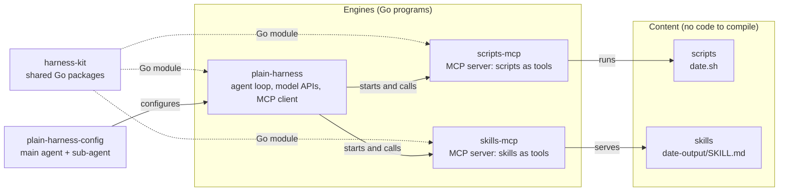

# harness-course

**Look inside an AI coding agent. A hands-on course on LLM agents, tools and harnesses, built on seven small repositories you can read in full.**

You probably code with an AI assistant already: Claude Code, Cursor, Copilot, Codex or similar. They feel like magic until one of them reads the wrong file, forgets what you said two turns ago, loops forever, or runs a command you didn't expect. To work well with these tools, and to judge what they produce, you need a mental model of what happens between your prompt and the answer. This course builds that model, by letting you take a working agent apart.

## Try it first

```sh
cd plain-harness-config/main-agent
../../plain-harness/bin/plain-harness "What time is it in Tokyo?"
```

The answer is **5 minutes ahead** of the real time in Tokyo. When you can explain exactly why, step by step and component by component, you have understood most of this course. (Run the [quick start](#quick-start) first; [Lab 0](labs/00-setup.md) has the details.)

## Who this is for

- **Computer science students** (from about the 3rd semester) who use AI to write code and want to understand how it works. You need to read basic Go (no prior Go experience required; the code is plain), bash, git, JSON and YAML. No machine learning background is needed: the model is a black box with an HTTP API, and the course is about everything *around* it.
- **Instructors** who want a lab-based module that runs locally with a free model: see [docs/instructors.md](docs/instructors.md).

## How you will learn

Each lab follows the same rhythm: **recall** earlier labs from memory, **predict** what will happen, **run** it, **investigate** the code that caused it, and only then read **the idea** behind it. After that you change the system, then build your own. One simple picture runs through the course: the *context ledger*, which shows exactly what the model receives in one call. This design follows research on how people learn to program; [docs/instructors.md](docs/instructors.md#how-the-course-teaches-and-why) explains the reasons and sources.

Start with [How the labs work](labs/README.md) (5 minutes).

## Course map

| Lab | You will | Time |
| --- | --- | --- |
| [0 Build and run](labs/00-setup.md) | draw your current mental model; build and run an agent; find its logs and memory | 45 min |
| [1 Be the harness](labs/01-be-the-harness.md) | run one agent turn by hand with `curl`: *you* are the harness | 60 min |
| [2 The loop](labs/02-the-loop.md) | read the 20-line agent loop, break it at each limit, watch the history grow | 60 min |
| [3 MCP by hand](labs/03-mcp-by-hand.md) | talk JSON-RPC to a tool server from the shell | 45 min |
| [4 Write a tool](labs/04-write-a-tool.md) | build a tool and your own agent; measure how descriptions steer the model; design a tool of your own | 120 min |
| [5 Measure the skill](labs/05-measure-the-skill.md) | run a small eval: how often is an instruction actually followed? Then write and measure your own skill | 120 min |
| [6 Sub-agents](labs/06-sub-agents.md) | trace context across two agents; redraw your Lab 0 model | 60 min |
| [7 Untrusted output](labs/07-untrusted-output.md) | trigger prompt injection; tell real boundaries from rules | 60 min |
| [8 Pin and set up](labs/08-reproducibility.md) | pinned versions, setup vs. run, strict config; pin your own agent | 60 min |
| [9 Build with AI](labs/09-spec-driven-feature.md) | extend the harness with an AI assistant, spec first | 2–4 h |
| [10 Review and transfer](labs/10-review.md) | recall the mechanisms from memory; draw your model a third time; explain a real AI tool | 60 min |

Reference: [the mental model on one page](docs/concepts.md) (for review), a [concept quiz](docs/concept-quiz.md) to take before and after the course, [architecture](docs/architecture.md), [glossary](docs/glossary.md).

## The system you will take apart

Everything a commercial coding agent does in principle (system prompts, the tool-calling loop, MCP, skills, sub-agents, sessions, retries, boundaries) shows up here in a form you can read, change and break on purpose:



| Repository | What it is | What you learn from it |
| --- | --- | --- |
| [plain-harness](https://github.com/harsig/plain-harness) | A CLI that runs one agent from a YAML file (~1,500 lines of Go). | the agent loop, provider adapters, sessions, retries |
| [scripts-mcp](https://github.com/harsig/scripts-mcp) | An MCP server that turns each shell script into a tool. | what a tool *is*: name, description, schema; validation; safe execution |
| [skills-mcp](https://github.com/harsig/skills-mcp) | An MCP server that turns each `SKILL.md` into a tool. | skills, and loading instructions only when they are needed |
| [harness-kit](https://github.com/harsig/harness-kit) | Go packages shared by the three programs. | sharing code without coupling; one set of config rules for all tools |
| [scripts](https://github.com/harsig/scripts) | Shell scripts served as tools (`date.sh`). | writing a tool a model can use correctly |
| [skills](https://github.com/harsig/skills) | Skills (`date-output`). | writing instructions a model follows |
| [plain-harness-config](https://github.com/harsig/plain-harness-config) | A main agent that hands date questions to a sub-agent. | prompt design, sub-agents, how the parts fit together |

Why this works for teaching:

- **Glass box, not black box.** Each mechanism lives in one small, named place. Students can point at the line a behavior comes from.
- **One mechanism per repository.** The harness knows nothing about dates, the tool server knows nothing about models, and the skill is plain markdown.
- **A visible canary.** The `date-output` skill tells the agent to add 5 minutes to every time. That is wrong on purpose: any answer shows whether the rule was applied, so "did it follow its instructions?" becomes something you can measure.
- **Spec-driven.** Each tool repository has a `spec.md` that describes its behavior completely, which is the way of working that pays off most when you code with AI.

## Quick start

The repositories must sit next to each other:

```text
<folder>/
  harness-course/   harness-kit/   plain-harness/   plain-harness-config/
  scripts/          scripts-mcp/   skills/          skills-mcp/
```

Clone them all into one folder:

```sh
for r in harness-course harness-kit plain-harness plain-harness-config scripts scripts-mcp skills skills-mcp; do
  git clone https://github.com/harsig/$r
done
```

You need Go 1.26.3 or newer, git, GNU `date` (on macOS: `brew install coreutils` and put its `gnubin` folder first in your `PATH`), and an OpenAI-compatible model server at `http://localhost:8080/v1`, for example [llama.cpp](https://github.com/ggml-org/llama.cpp)'s `llama-server` ([llama.cpp-compose](https://github.com/harsig/llama.cpp-compose) runs the model the configs expect in Docker). [Lab 0](labs/00-setup.md) covers hosted APIs as well.

```sh
(cd plain-harness && ./build.sh)
(cd skills-mcp && ./build.sh)
cd plain-harness-config
../plain-harness/bin/plain-harness --config main-agent/plain-harness.yml --setup
```
