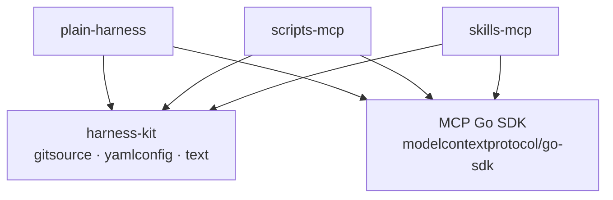
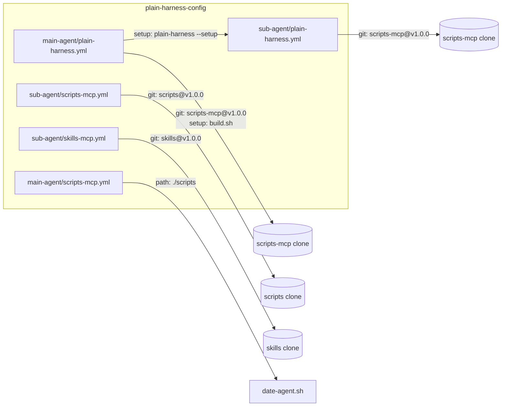
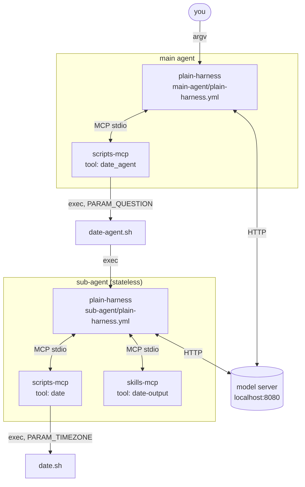
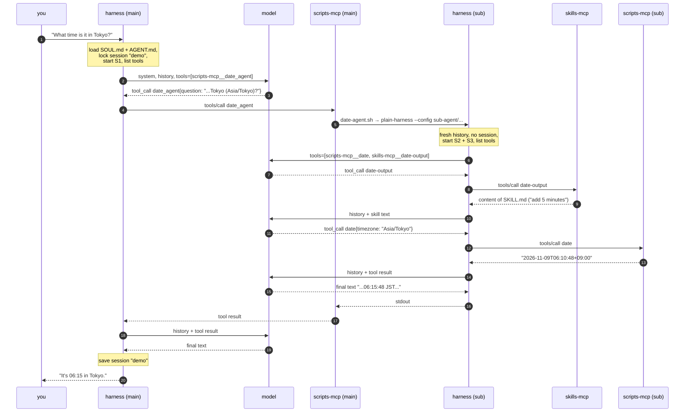

# Architecture: how the repositories connect

The seven repositories are connected in three different ways, at three different times. Mixing them up is the most common source of confusion, so this document keeps them apart.

| When | Connection | Example |
| --- | --- | --- |
| **Build time** | Go module dependency | `plain-harness`, `scripts-mcp` and `skills-mcp` import `github.com/harsig/harness-kit` |
| **Setup time** (`--setup`, uses the network) | git clone at a pinned `ref` | the sub-agent's `scripts-mcp.yml` clones `harsig/scripts` at `v1.0.0` |
| **Run time** (no network except the model API) | process start + MCP over stdin/stdout | `plain-harness` starts `scripts-mcp`, which starts `date.sh` |

## 1. Build time: one library, three programs



`harness-kit` holds only code that **more than one** tool needs (see its README). That rule is worth discussing: a shared library is tempting, but each shared package couples the tools together. Here, sharing is limited to things that must behave the same everywhere:

- `gitsource`: where a git source is cloned (`.<tool>/repos/<name>-<hash>/`), and the rule that a normal run never fetches.
- `yamlconfig`: strict loading, so an unknown key is an error in every tool, and relative paths resolve from the config file.
- `text.Truncate`: cutting output for a model at a byte limit without splitting a UTF-8 character.

Because of this, all three tools have the same config behavior: users learn the rules once.

## 2. Setup time: content comes from pinned git refs

The engines are generic; the content (which scripts, which skills, which prompts) is configuration. Content can live in its own git repository and is pulled in at a fixed `ref`:



One command, run in `plain-harness-config`, sets up the whole tree:

```sh
../plain-harness/bin/plain-harness --config main-agent/plain-harness.yml --setup
```

1. The main agent clones `scripts-mcp@v1.0.0`, runs its `build.sh`, then runs `scripts-mcp --setup` on `main-agent/scripts-mcp.yml` (a local path, nothing to clone).
2. The main agent's top-level `setup` runs `plain-harness --setup` for the **sub-agent** config.
3. The sub-agent clones and builds its own `scripts-mcp@v1.0.0`, which then clones `scripts@v1.0.0`. Its `skills-mcp` (built locally from the sibling repository) clones `skills@v1.0.0`.

Two design decisions to notice:

- **Setup and run are separate.** Only `--setup` touches the network for git. A normal run uses the local clones and fails with a hint if one is missing. A run is therefore repeatable: the same config gives the same tools, prompts and scripts.
- **The clone folder name contains a hash of URL and `ref`.** Changing a `ref` makes the existing clone invalid, so you cannot run against an outdated version by accident.

## 3. Run time: two agents, four servers, one question

Here is what happens for:

```sh
cd plain-harness-config/main-agent
../../plain-harness/bin/plain-harness --session demo "What time is it in Tokyo?"
```

### Processes



Notice: **the sub-agent is not a special feature of the harness.** It is a shell script, exposed as a tool, that happens to start another harness. Composition comes from plain Unix processes and stdout. Commercial agents ship sub-agents as a built-in feature, but the mechanism is the same: a separate model loop with its own, fresh context, whose final text becomes one tool result.

### Message flow



Count the model calls: **five** for one question (two in the main agent, three in the sub-agent). Each one sends the full history of its agent again. This is why agents are slower and more expensive than a single chat completion, and why the sub-agent's context staying small matters.

### What each component knows

| Component | Knows | Does not know |
| --- | --- | --- |
| model | the text it is sent: system prompt, history, tool definitions | that tools are scripts, that a sub-agent exists, what time it is |
| plain-harness | config, MCP servers, history | anything about dates; what a tool does |
| scripts-mcp | script headers, how to validate and run them | models, prompts, sessions |
| skills-mcp | `SKILL.md` files | when or why a skill is used |
| `date-agent.sh` | where the sub-agent config is | the main conversation |
| sub-agent | the one question it was given | the user, the conversation, earlier answers |

The bottom row is the point of [Lab 6](../labs/06-sub-agents.md): the main agent must turn "and in Berlin?" into a question that makes sense on its own, because the sub-agent has no history.

## 4. Where to find each mechanism in the code

| Mechanism | File and function |
| --- | --- |
| CLI wiring for one run | `plain-harness/src/main.go`: `run` |
| System prompt assembly | `plain-harness/src/main.go`: `loadSystemPrompt` (files joined with a blank line) |
| Provider-neutral message format | `plain-harness/src/types.go`: `Message`, `ToolCall`, `Provider` |
| Agent loop | `plain-harness/src/agent.go`: `Agent.Run` |
| Tool errors fed back to the model | `plain-harness/src/agent.go`: `Agent.callTool` |
| Retries and `Retry-After` | `plain-harness/src/agent.go`: `Agent.chat`, `http.go` |
| MCP client, tool namespacing `<server>__<tool>` | `plain-harness/src/mcp.go`: `Toolbox.add`, `toolName` |
| Environment allowlist for tool servers | `plain-harness/src/mcp.go`: `stdioEnv` |
| Translation to OpenAI / Anthropic wire formats | `plain-harness/src/openai.go`, `anthropic.go`: `messages`, `tools` |
| Session file, lock, atomic save | `plain-harness/src/session.go` |
| Script header to JSON schema | `scripts-mcp/src/script.go`: `parseHeader`, `InputSchema` |
| Argument validation, `PARAM_*` env | `scripts-mcp/src/script.go`: `Env` |
| Execution, timeout, process group kill | `scripts-mcp/src/script.go`: `Run`; `server.go`: `runScript` |
| Skill frontmatter to tool | `skills-mcp/src/skill.go`: `loadSkill`, `parseFrontmatter` |
| Skill call returns the file | `skills-mcp/src/server.go`: `readSkill` |
